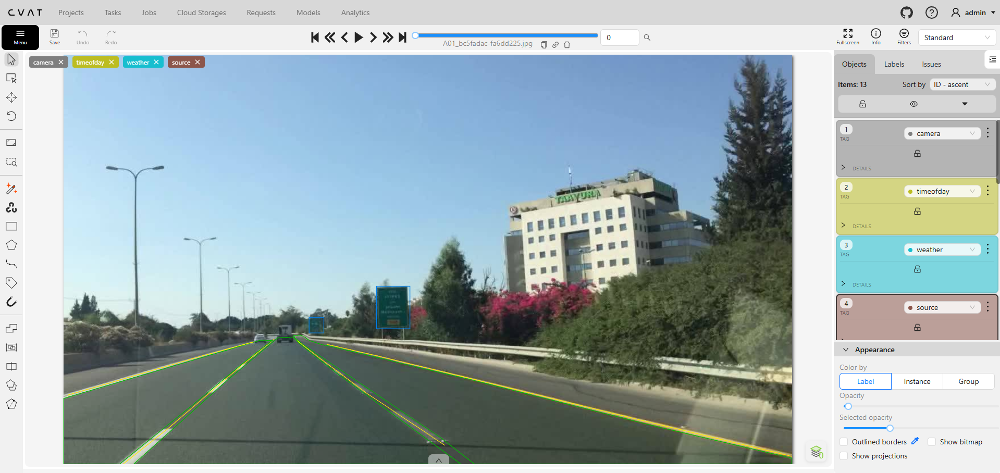
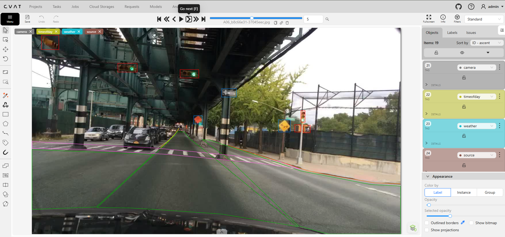
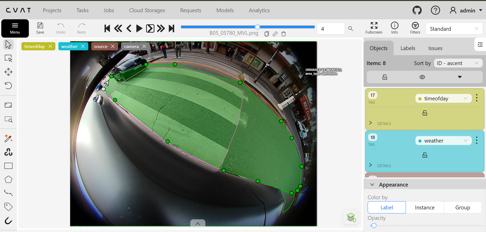
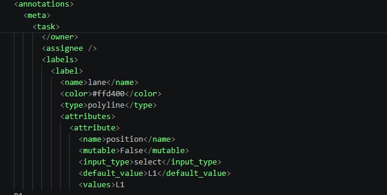

# Báo cáo cá nhân — Ngày 11
Họ tên: Phạm Đức Việt              Mã học viên: 2A202603265 
Phiên bản CVAT (Help → About): CVAT 2.81
Guideline: Road v1.0    Lần nộp (`revision` trong manifest): 1
Thời điểm export (ngày giờ trên CVAT): Nov 21st 26, 11:46    Số lần nộp lại sau Rework: 0
Link Google Drive nộp file zip: https://drive.google.com/drive/folders/1FKVYdoiW_xEFh9MnVzFDwPQdDgslvymC?usp=sharing

## 1. Kiểm project
| Mục | Đúng như guideline Road v1.0? | Ghi chú |
| --- | --- | --- |
| 6 label, đúng kiểu | Đúng | Đủ 6 nhãn: lane, road_curb, crosswalk, drivable, traffic_light, traffic_sign |
| Thuộc tính và giá trị | Đúng | Đầy đủ thuộc tính theo đúng taxonomy chuẩn của bài lab |
| 4 tag ảnh | Đúng | Đủ 4 tag: camera, timeofday, weather, source |
Cách kết thúc polyline trên bản CVAT này: Bấm phím N hoặc click đúp vào điểm cuối.  
Cách đặt tag ảnh trên bản CVAT này: Chọn công cụ Tag ở thanh công cụ bên trái, chọn label rồi chỉnh giá trị value trong tab Details.  

## 2. Số lượng đã gán
| Task | Ảnh | lane | road_curb | crosswalk | drivable | traffic_light | traffic_sign |
| --- | ---: | ---: | ---: | ---: | ---: | ---: | ---: |
| front | 12 | 26 | 9 | 4 | 25 | 22 | 11 |
| front-extra (đã làm 4 / 4) | 4 | 10 | 6 | 5 | 10 | 8 | 11 |
| fisheye | 8 | 6 | 13 | 6 | 12 | 5 | 4 |
| fisheye-extra (đã làm 0 / 4) | 0 | 0 | 0 | 0 | 0 | 0 | 0 |

## 3. Bảng ca khó
| Ảnh | Nhãn | Phân vân giữa | Đã chọn | Lý do |
| --- | --- | --- | --- | --- |
| A04 | drivable | Phân chia direct và alternative khi có dải đỗ xe | direct cho làn đang đi, né làn đỗ xe | Guideline quy định làn đỗ xe sát lề không tính vào direct |
| A05 | lane | Vẽ vạch giả định L1/R1 hay bỏ qua | Không vẽ vạch lane L1/R1 | Thực tế trên đường không có vạch sơn rõ ràng, không vẽ vạch giả (được miễn QC1-02) |
| B05 | lane | Đặt L1/R1 hay other | other | Quy tắc camera hai bên sườn (MVL/MVR): mọi lane đều gán position = other |

## 4. Phiếu QC 1 nhận được
Bạn kiểm lô của tôi: 2A202603293    Quyết định nhận được: Release (hoặc Rework nếu có lỗi)  
| Mã lỗi | Số lỗi | Đồng ý? | Đã sửa? |
| --- | ---: | --- | --- |
| QC1-01 | 1 | Đồng ý | Đã sửa tag camera B02 thành fisheye_front |
| QC1-03 | 2 | Đồng ý | Đã sửa position vạch lane ở B06, B07 thành other |

## 5. Kiểm file export
Link Google Drive nộp file zip theo yêu cầu của Lab Coach: https://drive.google.com/drive/folders/1FKVYdoiW_xEFh9MnVzFDwPQdDgslvymC?usp=sharing
| File | Mở lại được? | Số shape ảnh 1 (job / file) | Số shape ảnh 2 (job / file) | Tag camera có trong XML? |
| --- | --- | --- | --- | --- |
| 2A202603265-front.zip | Có | 9 | 5 | Có (front) |
| 2A202603265-fisheye.zip | Có | 6 | 8 | Có (fisheye_front) |

## 6. Ảnh chụp màn hình
*(Dán 4 ảnh chụp màn hình tương ứng vào đây trước khi nộp)*
1. Tab Labels của project.

2. Một ảnh camera trước đã gán đủ (làn, vùng lái, đèn/biển).

3. Một ảnh fisheye đã gán, phóng to đoạn polyline cong.

4. Một đoạn XML có `<polyline label="lane">`.

## 7. Tự đánh giá
Lỗi bạn mắc nhiều nhất hôm nay (theo mã QC1-xx), và cách tránh ở Ngày 20:  
Mắc lỗi QC1-03 (position vạch lane trên camera hai bên fisheye chưa đổi thành other) và QC1-01 (quên đổi tag camera cho ảnh fisheye_front). Cách tránh: Lập checklist rà soát kỹ các ảnh đặc thù (fisheye bên sườn) và kiểm tra lại Details của từng tag trước khi Finish job.

Nhãn của bạn đi vào model ở đâu? Chọn một lỗi đã sửa và nói nó làm model học sai thế nào:  
Nhãn `lane` và `drivable` đi vào nhánh phân đoạn (segmentation) và nhận diện vạch đường của mô hình nhận thức tự hành. Nếu để vạch ở camera bên sườn là L1/R1 thay vì other, model sẽ hiểu nhầm xe đang đi đè lên làn khác hoặc xác định sai tâm làn xe chạy, dẫn đến việc điều khiển vô lăng (LKA - Lane Keeping Assist) đánh lái sai lệch gây nguy hiểm.

## 8. (Tùy chọn, buffer) Từ polyline đến đích row-anchor
| y | 720 | 680 | 640 | 600 | 560 |
| --- | ---: | ---: | ---: | ---: | ---: |
| x của chúng tôi |  |  |  |  |  |
| x của bạn kia |  |  |  |  |  |

Trả lời 3 câu:
1. Năm số x đó chính là đích mà một model row-anchor học cho vạch này. Nếu bạn dừng polyline sớm 40 px, hàng nào đổi thành "không có làn"?  
Trả lời: Hàng ở phía xa nhất (ví dụ hàng y=560 hoặc 600) sẽ bị gán nhãn là không có làn do polyline không vươn tới được tọa độ y đó.
2. So với bạn được kiểm (cùng ảnh): ở hàng 720 và hàng 560, hai bạn lệch nhau bao nhiêu pixel? Lệch ở hàng nào ảnh hưởng LKA nhiều hơn (slide 25)?  
Trả lời: Lệch ở hàng 720 (sát mũi xe) ảnh hưởng nghiêm trọng đến LKA nhiều hơn vì đây là căn cứ trực tiếp để tính góc đánh lái và độ lệch tâm xe ngay tức thời.
3. Nếu polyline vẽ từ xa về gần (ngược quy tắc 2), cách tính trên có đổi không? Script nào sẽ gặp khó?  
Trả lời: Tọa độ hình học của vạch không đổi nhưng thứ tự các điểm trong mảng polyline bị đảo ngược, khiến các thuật toán nội suy và mô hình học chuỗi (như row-anchor hoặc lane RNN) gặp khó khăn khi xác định điểm bắt đầu và hướng tiến của làn xe.
